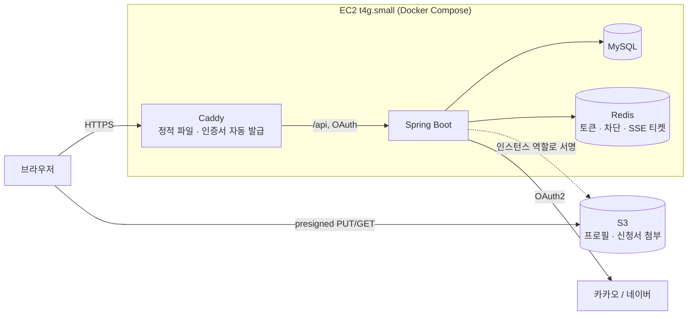
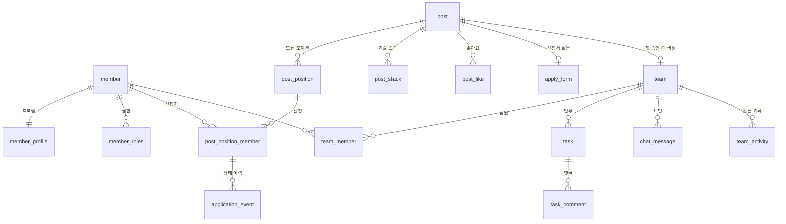
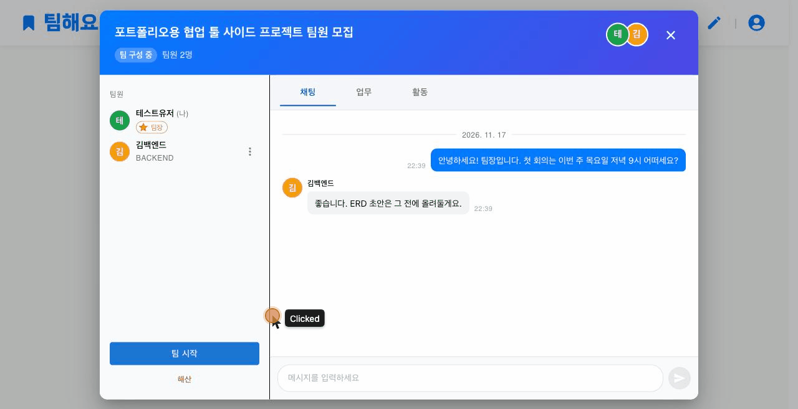

# 팀해요

스터디·프로젝트 팀원을 모집하고, 모인 팀이 바로 협업까지 이어 가는 서비스입니다.
모집글에 **신청서(질문·첨부 파일)** 를 붙여 받고, 작성자가 승인하면 **팀이 자동으로 만들어져** 업무 보드·채팅·활동 기록이 있는 팀 공간에서 함께 일합니다.
신청·승인·팀 변동은 **실시간 알림(SSE)** 으로 전달됩니다.

실무에서 다루던 동시성·데이터 정합성 문제를 설계부터 배포·운영까지 혼자 끝까지 맡아 보려고 만든 개인 프로젝트입니다. Spring Boot와 React로 개발했고, AWS에 직접 배포해 운영하고 있습니다.

### 한눈에 보기
- **성능**: 글 100만 건 기준 목록 첫 화면 **55.5초 → 9ms**. 조건부 쿼리, 정렬 인덱스, 건수 쿼리 제거 등을 단계마다 k6로 측정했습니다. ([7. 성능 개선](#7-성능-개선-모집글-목록-검색))
- **동시성·장애 대응**: 동시 좋아요 lost update와 데드락, 승인 정원 초과를 막는 락 순서, Redis 무응답 시 fail-closed를 테스트로 재현하고 검증했습니다. ([8. 트러블 슈팅](#8-트러블-슈팅))
- **보안**: Refresh Token 회전과 재사용(탈취) 탐지, 로그아웃·차단 시 토큰 즉시 무효화를 구현했습니다. 서버에는 오래 사는 AWS 키가 없습니다.

| 기간 | 내용 |
|---|---|
| 1차 2025.07.28 ~ 2025.09.17 | 회원·모집글·신청·마이페이지·관리자, AWS 첫 배포 |
| 2차 2026.11.02 ~ | TypeScript 전환, 신청서, 팀 공간(업무·채팅), 실시간 알림, 성능 개선, 테스트·CI, 재배포 |

2차 작업은 GitHub Flow로 진행했습니다. 작업마다 브랜치를 따고, PR 템플릿에 문제·원인·해결을 적은 뒤 CI를 통과하면 병합했습니다(병합된 PR 40여 개). 작업 중 발견한 버그는 별도의 `fix:` 커밋으로 남겼습니다. Claude Code로 개발하고, 결과는 테스트와 실제 실행 화면으로 검증했습니다.

## 1. 실제 사이트
[🌐 팀해요 바로가기](https://teamhaeyo.kro.kr/)

회원가입이나 카카오 로그인으로 바로 쓸 수 있고, 아래 체험용 계정으로 둘러볼 수도 있습니다.

| 구분 | 아이디 | 비밀번호 |
|---|---|---|
| 일반 사용자 | `test` | `test1234` |
| 관리자 | `admin123` | `admin123` |

`test` 계정에는 신청서가 있는 모집글, 답변을 단 대기 중인 신청, 팀 공간(업무·채팅)이 미리 들어 있습니다.
체험용 계정은 공개되어 있어서 화면은 모두 볼 수 있지만, 관리자 기능(회원 차단·글 숨김)과 회원정보·비밀번호 수정은 막혀 있습니다.

## 2. 기술 스택
| 분야 | 기술 |
|------|------|
| **Backend** |      |
| **Frontend** |    |
| **Database / Cache** |   |
| **Infra** |     |
| **Test / CI** |    |

## 3. 아키텍처

- **비용을 최소로**: RDS·ElastiCache·CloudFront 대신 EC2 한 대에 앱·MySQL·Redis·Caddy를 컨테이너로 올렸습니다. 월 20달러 안팎입니다.
- **오래 사는 키 없음**: 서버는 EC2 인스턴스 역할로 S3에 접근하고, SSH 없이 SSM으로만 접속합니다. 포트는 80·443만 열려 있습니다.
- **파일은 서버를 거치지 않음**: 브라우저가 presigned URL로 S3에 직접 올립니다. 신청서 첨부는 비공개 경로에 두고 5분짜리 다운로드 URL만 줍니다.
- **서버 한 대 전제**: 실시간 알림·채팅은 SSE 연결을 서버 메모리에 둡니다. 서버를 늘리려면 Redis Pub/Sub이 필요합니다.
- **CI**: PR마다 GitHub Actions가 MySQL·Redis 컨테이너를 띄우고 백엔드 통합 테스트(JUnit, `@SpringBootTest` 18개 클래스: 권한·동시성·장애·SSE)를 돌립니다. 프론트는 타입 검사, 테스트, 빌드를 돌립니다.
- 배포 절차: [`deploy/README.md`](deploy/README.md)

## 4. 프로세스 흐름도

## 5. ERD

- **post_position_member**: 신청 한 건과 현재 상태(대기·승인·거절·탈퇴·퇴출)입니다. (포지션, 회원) 유니크 제약으로 중복 신청을 막고, 답변은 제출 당시 질문 모습 그대로 JSON으로 복사해 둡니다. 상태가 바뀔 때마다 `application_event`에 이력을 남깁니다.
- **apply_form**: 글마다 작성자가 만든 질문(JSON)입니다. 목록 API가 `post`를 통째로 읽기 때문에 `post` 쪽 연관으로 두지 않았습니다.
- **team / team_member**: 팀장은 글 작성자이고 `team.leader_member_id` 한 칸에 둬서 팀장이 둘일 수 없습니다. 상태는 `FORMING → ACTIVE → COMPLETED` 또는 `DISBANDED`입니다.
- **task**: `version` 컬럼(낙관적 락)으로 동시 수정을 막고, 상태 변경은 조건부 UPDATE라 연타해도 한 번만 바뀝니다.
- **notification / chat_message**: MySQL에 저장하고, 커밋된 뒤에만 SSE로 보냅니다.
- 스키마는 Flyway(`V1`~`V7`)로 관리합니다.

## 6. 주요 기능
- **회원**: JWT 인증, 카카오·네이버 소셜 로그인, 기기별 Refresh Token 회전과 재사용 탐지, 로그아웃 토큰 블랙리스트, 관리자 차단 시 토큰 즉시 무효화
- **모집·신청**: 기술 스택·지역·포지션 검색과 필터, 신청서(짧은 글·긴 글·선택·링크·파일) 작성과 서버 검증, 신청·승인·거절
- **팀 공간**: 첫 승인 때 팀 자동 생성, 팀장 위임·탈퇴·퇴출, 업무 보드와 댓글, 팀 채팅, 활동 기록
- **실시간 알림**: 신청·승인·팀 변동·업무 배정을 SSE로 전달하고, 다시 연결되면 놓친 알림을 다시 받습니다.
- **마이페이지**: 내가 작성·신청·참여·좋아요한 글, 프로필 이미지 업로드
- **관리자**: 대시보드(회원·글·매칭 수), 회원 차단, 글 숨김

### 팀 공간 (2차)
채팅 → 업무 추가 → 업무 상태 이동 → 활동 기록 → 팀 시작

### 시연 영상 (1차 버전 화면)
| 회원가입·로그인 | 모집글·신청 |
|---|---|
|  |  |
| **마이페이지** | **관리자 페이지** |
|  |  |

## 7. 성능 개선: 모집글 목록 검색
메인 목록 API를 글 100만 건 더미 데이터로 측정했습니다. 고칠 때마다 같은 시나리오로 다시 쟀고, 자세한 과정은 [`perf/README.md`](perf/README.md)에 있습니다.

| 시나리오 | 개선 전 | 개선 후 |
|---|---:|---:|
| 첫 화면 (최신순) | 55.5초 | **9ms** |
| 인기순 | 51.5초 | **7ms** |
| 프로젝트 + 모집중 | 31.2초 | **7ms** |
| 키워드 검색 | 13.0초 | **13ms** |
| 10,001번째 페이지 | 60.6초 | **23ms** |

> 측정 조건: 로컬 MacBook(16GB)의 Docker MySQL 8.0(버퍼 풀 512MB)과 Spring Boot 앱 한 대. 회원 1만, 글 100만, 신청 96만 건. k6로 **사용자 1명이 순서대로** 호출하고, 워밍업 1회 뒤 3회 잰 **중앙값**입니다. 동시 부하 측정이 아니고, 실제 트래픽이 아닌 더미 데이터 기준입니다.

1. **들어온 조건만 쿼리에 넣기**: 고정 JPQL이 포지션·스택을 조인한 뒤 `DISTINCT`로 중복을 지우고 있었습니다. `Specification`으로 값이 있는 조건만 넣고, 포지션·스택 조건은 `EXISTS`로 바꿔 `DISTINCT`를 없앴습니다. 바꾸기 전에 기존 동작을 테스트로 고정했습니다. (55.5초 → 1.2초)
2. **정렬을 인덱스로**: 최신순 기준 `COALESCE(updated, created)`를 생성 컬럼으로 만들고 `(last_modified, id)` 인덱스를 걸었습니다. 정렬 없이 인덱스를 거꾸로 읽다가 한 페이지가 차면 멈춥니다. (1.2초 → 90ms)
3. **SQL 개수 줄이기**: 응답에서 신청자 목록을 빼고(비로그인에 신청자 아이디가 노출되던 보안 수정), 글마다 기술 스택·포지션을 따로 읽던 N+1을 `default_batch_fetch_size`로 묶었습니다. 요청당 SQL이 36개에서 4개로 줄었습니다.
4. **전체 건수 대신 "앞으로 10페이지까지"만 확인**: 남은 시간 대부분이 `COUNT(*)`였습니다. 화면은 페이지 버튼만 그리므로 현재 위치부터 `페이지 크기 × 10 + 1`개의 id만 인덱스로 읽습니다. (90ms → 9ms)

10,001번째 페이지가 빨라진 것은 2번과 4번 덕분입니다. 앞의 5만 건을 건너뛸 때 정렬된 인덱스에서 **id만** 넘기므로 테이블 행을 읽지 않고(커버링 인덱스), 매 요청 100만 건을 세던 건수 쿼리도 없어졌습니다.

남은 약점도 적어 둡니다. 결과가 없는 키워드(4.0초)와 드문 기술 스택(1.1초)은 조건에 맞는 글이 드물수록 많이 훑어야 해서 느립니다. MySQL ngram 전문 검색도 시험해 봤습니다. 드문 키워드는 빨라졌지만, 흔한 키워드("스터디" 33만 건)는 일치하는 글을 전부 모아 정렬해서 오히려 느려졌습니다. 흔한 구문을 검색하다 MySQL이 메모리 부족으로 종료되기도 해서 쓰지 않았습니다.

## 8. 트러블 슈팅
### 8-1. 동시 좋아요에서 좋아요 수가 줄거나 음수가 되던 문제
- **문제**: 10명이 같은 글에 동시에 좋아요하면 좋아요 행은 10개인데 `like_count`는 2였습니다. 누른 적 없는 사람이 취소를 보내도 수가 줄어 -1이 됐습니다.
- **원인**: 글을 읽어 `like_count + 1`을 엔티티에 넣고 저장해서 동시 요청이 서로의 증가분을 덮어썼습니다(lost update). 취소는 실제로 지운 행이 있는지 보지 않았습니다.
- **해결**: 좋아요는 `INSERT IGNORE`로 넣고, 행이 실제로 생기거나 지워졌을 때만 DB에서 수를 더하고 뺍니다. 그러자 INSERT의 외래키 검사가 글 행에 공유 락을 걸어 이어지는 UPDATE와 데드락이 났습니다(10건 중 8건 롤백). 그래서 글 행을 먼저 `SELECT FOR UPDATE`로 잡아 락 순서를 고정했습니다. 동시성 테스트로 검증합니다.
- **트레이드오프**: 이 방식은 같은 글의 좋아요를 한 줄로 세웁니다. 이 서비스는 한 글에 좋아요가 몰리는 일이 드물어 정확성을 택했습니다. 몰린다면 좋아요 수를 Redis에 모았다가 주기적으로 반영하는 방식으로 바꿀 수 있습니다.

### 8-2. Redis 장애 때 모든 요청이 멈추던 문제
- **문제**: Redis가 응답하지 않으면 공개 API까지 요청마다 60초씩 멈췄습니다.
- **원인**: 인증 필터가 매 요청 Redis에서 토큰 폐기 여부를 확인하는데, Lettuce 기본 타임아웃이 60초였습니다.
- **해결**: 타임아웃을 1초로 줄였습니다. 확인하지 못하면 인증하지 않고 비로그인으로 넘기는 fail-closed로 바꿨습니다. 로그인이 필요한 API는 401(프론트가 로그아웃시킴) 대신 503을 줍니다. 연결 거부와 무응답 두 경우를 테스트로 검증합니다.

### 8-3. 열린 알림 구독이 DB 커넥션을 쥐고 있던 문제
- **문제**: 알림 구독자가 커넥션 풀 크기만큼 생기면 다른 API가 커넥션을 얻지 못했습니다.
- **원인**: OSIV(Open Session In View)는 요청이 끝날 때까지 DB 커넥션을 붙잡습니다. SSE 구독 요청은 끝나지 않고 계속 열려 있어서 커넥션도 반납되지 않았습니다.
- **해결**: **구독 경로만 OSIV에서 제외**했습니다. 다른 API는 지연 로딩을 그대로 쓸 수 있게 했습니다. Spring 설정으로는 경로별로 끌 수 없어서, 전역 OSIV를 끄고 같은 인터셉터를 구독 경로만 빼고 직접 등록했습니다.

## 9. 향후 개선점
- 서버를 여러 대로 늘릴 때 SSE 전달을 Redis Pub/Sub으로 전환
- 업무 보드 드래그 앤 드롭
- GitHub Actions에서 OIDC로 자동 배포
