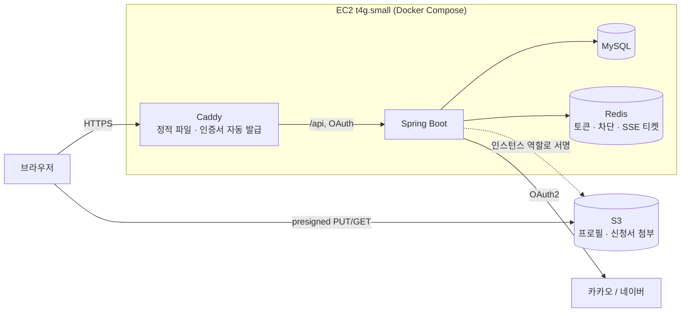

# 👤 팀해요
이 프로젝트는 **Spring Boot + React + DB** 를 활용하여  
풀스택 개발 전 과정을 경험하기 위해 진행한 개인 프로젝트입니다.
팀이 없어도 협업 경험을 흉내 내고, 실제 배포까지 경험하며 백엔드 인증, 프론트 상태 관리, 클라우드 배포까지 구현하였습니다.

개발 기간 : 25.07.28 ~ 25.09.17

## 🚀 1. 프로젝트 소개 (About)
혼자서 프로젝트하거나 공부할 때 누군가와 같이 하고싶다고 생각해본적이 있나요? 그럴 때 필용한 서비스입니다!

## 2. 🔗 실제 사이트
[🌐 팀해요 - 실제 서비스 바로가기](https://teamhaeyo.kro.kr/)

AWS EC2 한 대에서 운영합니다. 카카오 로그인 또는 회원가입으로 바로 사용해 볼 수 있습니다.

## 🛠️ 3. 사용 언어 / 기술 스택 (Languages & Tech Stack)
| 분야 | 기술 |
|------|------|
| **Backend** |      |
| **Frontend** |    |
| **Database / Cache** |   |
| **Infra** |     |
| **Test / CI** |    |

## 4. 아키텍처

- **비용을 최소로**: RDS·ElastiCache·CloudFront 대신 EC2 한 대에 앱·MySQL·Redis·Caddy를 컨테이너로 올렸습니다. 월 20달러 안팎입니다.
- **오래 사는 키 없음**: 서버는 EC2 인스턴스 역할로 S3에 접근하고, SSH 없이 SSM으로만 접속합니다(포트는 80·443만 열림).
- 실시간 알림·채팅은 SSE 연결을 서버 메모리에 두므로 서버 한 대를 전제로 합니다. 늘릴 때는 Redis Pub/Sub이 필요합니다.
- 배포 절차: [`deploy/README.md`](deploy/README.md)

## 5. 프로세스 흐름도

## 6. ERD
아래 ERD는 스터디/프로젝트 매칭 플랫폼의 데이터베이스 구조를 나타냅니다.
회원(Member), 모집글(Post), 신청(post_position_member), 팀(Team) 등을 중심으로 설계되었으며, 각 테이블은 다음과 같은 역할을 합니다.

> 이미지는 팀 기능(2.0) 전 구조입니다. 이후 추가된 테이블은 아래 설명에 함께 적었습니다.
### 주요 테이블 설명
- **member**  
  사용자 계정을 관리하는 테이블입니다.  
  - 이메일, 비밀번호, 닉네임, 소셜 로그인 제공자 등의 정보를 저장합니다.  
  - `member_profile`과 연결되어 사용자의 자기소개 및 선호 포지션을 관리합니다.  
  - `member_roles`를 통해 권한(관리자, 일반 사용자 등)을 부여합니다.  

- **post**  
  프로젝트/스터디 모집 글을 관리합니다.  
  - 작성자(author), 제목, 내용, 모집 분야, 모집 인원, 지역, 모집 상태 등을 저장합니다.  
  - `post_stack`으로 필요한 기술 스택을, `post_position`으로 모집 포지션을 정의합니다.  

- **post_position_member**  
  특정 포지션에 지원한 멤버와 그 상태(대기/승인/거절/탈퇴/퇴출)를 관리합니다. (포지션, 회원) 유니크 제약으로 중복 신청을 막고, 상태가 바뀔 때마다 `application_event`에 이력을 남깁니다.  
- **post_like**  
  게시글에 달린 좋아요 정보를 관리합니다.
- **team / team_member**
  모집글의 첫 승인 때 자동으로 만들어지는 팀과 팀원입니다. 팀장은 글 작성자이고, 상태는 `FORMING → ACTIVE → COMPLETED` 또는 `DISBANDED`입니다.
- **task / task_comment / team_activity**
  팀 업무(칸반)와 댓글, 팀 활동 기록입니다. 업무는 `version` 컬럼으로 동시 수정을 막습니다.
- **chat_message / notification**
  팀 채팅과 알림입니다. MySQL에 저장한 뒤 커밋되면 SSE로 보냅니다.
- **apply_form**
  글마다 작성자가 만든 신청서 질문(JSON)입니다. 답변은 신청 행에 제출 당시 모습으로 복사합니다.

스키마는 Flyway(`V1`~`V7`)로 관리합니다.

## 7. 주요 기능 소개
- **회원가입/로그인**: JWT 인증, 카카오·네이버 소셜 로그인. Redis로 기기별 Refresh Token 회전과 재사용(탈취) 탐지, 로그아웃 토큰 블랙리스트, 관리자 차단 시 토큰 즉시 무효화
- **프로젝트/스터디 모집**: 모집글 작성, 기술 스택·지역·포지션 검색과 필터, 신청서(질문·첨부 파일) 작성, 신청·승인·거절
- **팀 공간**: 첫 승인 때 팀 자동 생성, 팀장 위임·탈퇴·퇴출, 업무 보드와 댓글, 팀 채팅, 활동 기록
- **실시간 알림**: 신청·승인·팀 변동·업무 배정을 SSE로 전달, 끊겼다가 다시 붙으면 놓친 알림을 다시 받음
- **마이페이지**: 내가 작성·신청·참여·좋아요한 글, S3 프로필 이미지 업로드
- **관리자 페이지**: 대시보드(회원·글·매칭 수), 회원 차단, 글 숨김

- 프로젝트/스터디 모집 : 모집글 작성, 기술 스택/지역/포지션 기반 검색 및 필터링, 지원·승인 워크플로우

- 마이페이지 : 내가 작성/신청/매칭/좋아요한 글 관리, S3 기반 프로필 이미지 업로드
  

- 관리자페이지: 대시보드 기능(사용자, 게시글, 포지션 매칭 수 등), 사용자 계정 관리, 게시물 관리 기능
  

## 8. 성능 개선: 모집글 목록 검색
글 100만 건 더미 데이터로 메인 목록 API를 k6로 측정하고, 고칠 때마다 같은 시나리오로 다시 쟀습니다. 자세한 과정은 [`perf/README.md`](perf/README.md)에 있습니다.

| 시나리오 | 개선 전 | 개선 후 |
|---|---:|---:|
| 첫 화면 (최신순) | 55.5초 | **9ms** |
| 인기순 | 51.5초 | **7ms** |
| 프로젝트 + 모집중 | 31.2초 | **7ms** |
| 키워드 검색 | 13.0초 | **13ms** |
| 10,001번째 페이지 | 60.6초 | **23ms** |

- 들어온 조건만 쿼리에 넣고 포지션·스택 조건은 `EXISTS`로 바꿈
- 정렬 기준을 생성 컬럼 + 인덱스로 만들어 정렬 없이 읽음
- 목록의 연관 데이터를 IN으로 묶어 요청당 SQL을 36개에서 4개로 줄임
- 전체 건수 `COUNT` 대신 "앞으로 10페이지까지"만 확인

## 9. 트러블 슈팅
### 9-1. 동시 좋아요에서 좋아요 수가 줄거나 음수가 되던 문제
- **문제**: 10명이 같은 글에 동시에 좋아요하면 좋아요 행은 10개인데 `like_count`는 2였습니다. 누른 적 없는 사람이 취소를 보내도 수가 줄어 -1이 됐습니다.
- **원인**: 글을 읽어 `like_count + 1`을 엔티티에 넣고 저장해서, 동시 요청이 서로의 증가분을 덮어썼습니다(lost update). 취소는 실제로 지운 행이 있는지 보지 않았습니다.
- **해결**: 좋아요는 `INSERT IGNORE`로 넣고 행이 실제로 생기거나 지워졌을 때만 DB에서 수를 더하고 뺍니다. 이번에는 INSERT의 외래키 검사가 글 행에 공유 락을 걸어 이어지는 UPDATE와 데드락이 났습니다(10건 중 8건 롤백). 그래서 글 행을 먼저 `SELECT FOR UPDATE`로 잡아 락 순서를 고정했습니다. 동시성 테스트로 검증합니다.

### 9-2. Redis 장애 때 모든 요청이 멈추던 문제
- **문제**: Redis가 응답하지 않으면 공개 API까지 요청마다 60초씩 멈췄습니다.
- **원인**: 인증 필터가 토큰 폐기 여부를 Redis에서 확인하는데, Lettuce 기본 타임아웃이 60초였습니다.
- **해결**: 타임아웃을 1초로 줄이고, 확인하지 못하면 비로그인으로 넘기는 fail-closed로 바꿨습니다. 로그인이 필요한 API는 401(프론트가 로그아웃시킴) 대신 503을 줍니다. 연결 거부와 무응답 두 경우를 테스트로 검증합니다.

### 9-3. 열린 알림 구독이 DB 커넥션을 쥐고 있던 문제
- **문제**: 알림 구독자가 커넥션 풀 크기만큼 생기면 다른 API가 커넥션을 얻지 못했습니다.
- **원인**: OSIV가 켜져 있어 SSE 요청이 열려 있는 동안 DB 커넥션을 반납하지 않았습니다.
- **해결**: OSIV를 끄고, 같은 인터셉터를 구독 경로만 빼고 직접 걸었습니다.

### 9-4. 공유 도메인(kro.kr) 인증서 발급 실패
- **문제**: 배포 후 HTTPS 인증서를 받지 못해 사이트에 접속할 수 없었습니다.
- **원인**: Let's Encrypt가 "kro.kr에 최근 7일간 이미 50장 발급됨"으로 거절했습니다. 여러 사람이 나눠 쓰는 상위 도메인이라 주간 한도가 늘 차 있습니다.
- **해결**: Caddy에 ACME 계정 이메일을 넣어, Let's Encrypt가 실패하면 ZeroSSL로 넘어가 받게 했습니다.

## 10. 향후 개선점
- 서버를 여러 대로 늘릴 때 SSE 전달을 Redis Pub/Sub으로 전환
- 업무 보드 드래그 앤 드롭
- GitHub Actions에서 OIDC로 자동 배포
