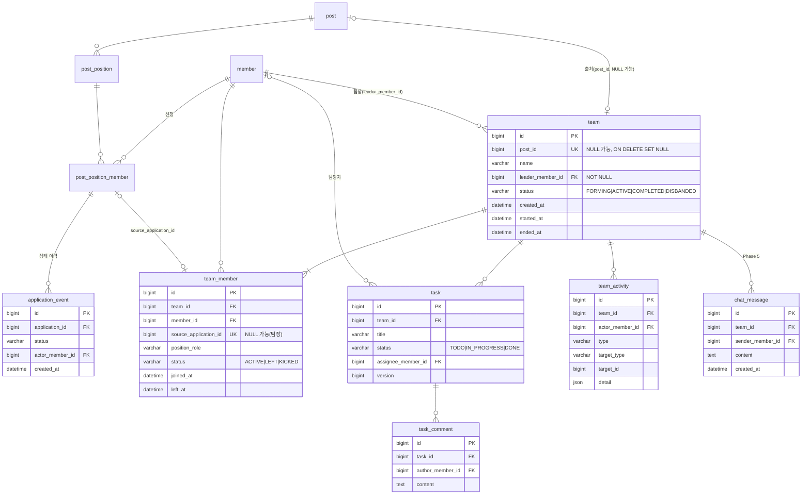

# 팀해요 2.0 — 팀 구성·협업 도메인 설계

모집글로 모인 사람들이 같은 서비스 안에서 팀을 꾸리고, 업무(Task)를 나눠 진행하고, 프로젝트를 끝내기까지 관리한다.
기존 Spring Boot·JPA·MySQL·Redis·SSE 구성을 그대로 쓰고 새 인프라는 들이지 않는다.

> 상태: 설계 3차안. **Phase 1(팀 자동 생성, 내 팀 화면), Phase 2(멤버 관리, V4 알림 확장), Phase 3(업무, V5)을 구현했다.** Phase 4 이후는 설계만 있다.
>
> **전제: 운영 중인 DB가 없다.** 이관할 기존 데이터도, 맞춰야 할 운영 스키마도 없다. 첫 배포는 빈 DB에 Flyway가 V1부터 차례로 만든다.

### 변경 이력

| 판 | 내용 |
|---|---|
| 1차 | 도메인·ERD·API·동시성·테스트·단계 계획 초안 |
| 3차 | 운영 DB 없음을 반영. 기존 데이터 이관(V4)과 "팀 생성 때 기존 승인 흡수" 규칙, 운영 스키마 비교 항목을 뺐다. 마이그레이션 번호를 다시 매겼다 |
| 2차 | 정책 4가지 확정(§0), 팀장 지정과 작성자 매핑(§2.3), 재지원과 신청 이력(§2.4, `application_event` 추가), 기존 데이터 이관 전략·검증 SQL, 채팅 확장 구체화(§6.3), 구현 전 검증 결과. 테스트 시나리오·단계 계획 갱신 |

---

## 0. 확정 정책

| # | 정책 | 결정 |
|---|---|---|
| 1 | 팀 생성 시점 | **첫 승인 때 자동 생성**한다. 승인과 같은 트랜잭션에서 처리한다 |
| 2 | 팀원 탈퇴 시 정원 | **다시 연다.** 정원은 `ACCEPT`만 세므로 탈퇴(`WITHDRAWN`)·퇴출(`EXPELLED`)한 자리는 다시 모집된다 |
| 3 | 팀이 있는 모집글 삭제 | **막는다.** `DISBANDED`가 아닌 팀이 있으면 409를 준다 |
| 4 | 관리자 팀 열람 | **불허한다.** 팀원이 아니면 관리자도 404를 받는다 |

---

## 1. 현재 구조 분석

### 1.1 관련 도메인

| 도메인 | 테이블 | 핵심 동작 |
|---|---|---|
| 회원 | `member`, `member_profile`, `member_roles` | soft delete(`del_yn`). 앱은 회원을 하드 삭제하지 않는다. username을 바꾸는 경로가 없다 |
| 모집글 | `post` → `post_position` → `post_position_member` | 작성자는 `post.author`(**username 문자열, FK 아님**) |
| 신청·승인 | `post_position_member.status` = `APPLY`/`ACCEPT`/`REJECT` | `(post_position_id, member_id)` 유니크(`uk_position_member`). 승인·거절은 글 행 `SELECT FOR UPDATE` 후 정원 확인 |
| 알림 | `notification` | `receiver`(username), `type` 길이 10, 글 정보를 복사해 둔다. 커밋 후 SSE로 전송 |

### 1.2 설계에 영향을 주는 사실 (코드 근거)

1. **승인 이후 흐름이 없다.** 승인 취소·탈퇴가 없다. 정원은 `ACCEPT` 행 수로 센다(`findCountByPostPositionId`).
2. **글 삭제는 JPA 연쇄 하드 삭제다.** `Post.positions`·`likes`·`techStacks`, 그리고 `PostPosition.positionMemberList` 모두 cascade ALL과 orphanRemoval이다. DB FK는 전부 `NO ACTION`(§9.4)이다. 그래서 자식 행 삭제는 DB가 아니라 Hibernate가 한다.
3. **작성자는 토큰 사용자로 고정된다.** `PostController.createPost`가 `post.setAuthor(principal.getName())`로 저장한다(2026-11-03 `8163aaf` 이후). 운영 데이터가 없으므로 그 이전 방식(요청 본문)으로 저장된 글은 고려하지 않는다.
4. **자기 글에는 신청할 수 없다**(`feat/apply-form`에서 추가, `main`에 병합됨). 그래서 작성자가 자기 글의 팀원이 되는 경우는 없다.
5. **한 사람이 같은 글의 여러 포지션에 신청할 수 있다.** 유니크 제약이 포지션 단위이기 때문이다. 팀원은 한 팀에 한 번만 들어가야 하므로, 이미 팀원인 사람의 추가 승인을 막아야 한다(§2.4).
6. **동시성 규칙이 이미 있다.** 글 행 잠금이 트랜잭션의 첫 조회여야 한다(REPEATABLE READ 스냅샷 문제). 팀 쪽 잠금도 이 순서를 따른다.
7. **알림이 글 중심이다.** `type`이 10자이고 `post_*` 컬럼만 있다.
8. **SSE 연결은 서버 메모리에 있다.** 서버가 한 대일 때만 맞다. 알림의 SSE 이벤트 id는 알림 id다.

---

## 2. 도메인 구조

```
모집(Recruit)                         팀(Team)                          협업(Collaboration)
post ─ position ─ application ─승인─▶ team_member ◀── team ──▶ task ──▶ task_comment
                     │                (멤버십)         │  └──▶ chat_message (Phase 5)
                     └─▶ application_event             └────▶ team_activity (변경 이력·활동 피드)
                          (신청 상태 이력)
```

- 팀은 모집글에서 생기지만 글에 종속되지 않는다. 글 제목을 팀 이름으로 복사하고, `post_id`는 출처를 가리키는 값으로만 쓴다.
- 팀 상태: `FORMING`(모집 중) → `ACTIVE`(팀장이 시작) → `COMPLETED` 또는 `DISBANDED`(둘 다 읽기 전용).
- 이력:
  - 신청 상태 변화는 `application_event`에 남긴다. 재지원 때문에 신청 행 하나가 여러 번 순환하므로 별도로 둔다.
  - 팀 안의 일(멤버 변동, 팀장 변경, 업무, 댓글)은 `team_activity`에 남긴다.

### 2.1 권한 체계

| 동작 | 팀장 | 팀원 | 그 외(관리자 포함) |
|---|---|---|---|
| 팀·업무·댓글·활동·채팅 조회 | O | O | X(404) |
| 업무 생성·수정·상태 변경, 댓글·채팅 작성 | O | O | X |
| 업무 삭제 | O | 본인이 만든 업무만 | X |
| 댓글 삭제 | O | 본인 댓글만 | X |
| 팀 시작·완료·해산, 팀원 퇴출, 팀장 위임 | O | X | X |
| 팀 탈퇴 | 위임 후에만 | O | — |

**팀장 유일성은 구조로 보장한다.** `team.leader_member_id`(NOT NULL) 한 칸에 팀장을 두므로 팀장이 둘일 수 없다. MySQL에는 부분 유니크 인덱스가 없어서 `role` 컬럼으로는 "팀당 1명"을 강제하기 어렵다. "팀장은 활성 팀원이어야 한다"는 팀 행을 잠근 상태에서 애플리케이션이 확인한다.

### 2.2 멤버십 정책

| 상황 | 정책 |
|---|---|
| 팀원 탈퇴 | `team_member.status = LEFT`, 신청은 `ACCEPT` → `WITHDRAWN`. 담당 업무의 담당자를 비운다. 포지션·글의 모집 상태(`status`)를 다시 계산해 자리를 연다 |
| 강제 퇴출 | 팀장만 할 수 있다. `team_member.status = KICKED`, 신청은 `EXPELLED`. 나머지 처리는 탈퇴와 같다 |
| 팀장 탈퇴 | 먼저 위임해야 한다(409). 혼자 남은 팀장은 해산만 할 수 있다 |
| 팀 완료 | `COMPLETED`. 쓰기 API는 모두 409. 데이터는 계속 보인다 |
| 팀 해산 | `DISBANDED`. 소프트 삭제이고 데이터는 보존한다 |
| 모집글 삭제 | `DISBANDED`가 아닌 팀이 있으면 409. 해산된 팀만 있으면 삭제를 허용한다. 이때 팀은 `post_id = NULL`로 남고, 연쇄 삭제되는 신청을 가리키던 `team_member.source_application_id`도 NULL이 된다 |
| 관리자 글 숨김(`del_yn`) | 팀에는 영향이 없다 |
| 회원 차단 | 팀 데이터는 그대로 둔다. 차단된 팀장의 팀은 쓰기가 멈춘다. 관리자 위임 기능은 범위 밖이다 |

### 2.3 팀장 지정과 작성자 매핑

**규칙: 팀장은 모집글 작성자다.** 작성자는 `member.username = post.author`인 회원이다. 첫 승인자나 다른 회원을 대신 팀장으로 지정하지 않는다.

- 승인은 작성자만 호출할 수 있다. `lockAndFindOwnedApplication`이 `Principal`의 이름과 `post.author`를 비교하기 때문이다. 작성자는 토큰 사용자로 저장되므로, 승인 요청이 들어왔다는 것은 그 username의 회원이 있다는 뜻이다. 정상 경로에서 매핑은 실패하지 않는다.
- 그래도 회원 조회(`findByUsername(post.author)`)가 실패하면 데이터가 깨진 것이다.
  - `IllegalStateException`(409) "작성자 회원 정보를 찾을 수 없어 승인할 수 없습니다"를 던지고 **승인까지 롤백**한다. 승인은 됐는데 팀이 없는 반쪽 상태를 만들지 않는다.
  - 에러 로그에 `post_id`와 `author`를 남긴다.
- 팀은 첫 승인 때만 만든다. 팀이 생기기 전의 `ACCEPT`는 존재할 수 없다(첫 `ACCEPT`와 팀 생성이 같은 트랜잭션이다). 그래서 기존 승인을 흡수하는 처리는 두지 않는다.

### 2.4 재지원과 신청 이력

#### 신청 상태

| 상태 | 의미 | 정원 계산 | 재지원 |
|---|---|---|---|
| `APPLY` | 대기 | 제외 | — |
| `ACCEPT` | 승인(팀원) | **포함** | — |
| `REJECT` | 거절 | 제외 | 불가(현행 유지) |
| `WITHDRAWN` | 자진 탈퇴 | 제외 | **가능** |
| `EXPELLED` | 강제 퇴출 | 제외 | 불가 |

컬럼이 VARCHAR라 스키마 변경 없이 값만 추가한다. 정원 쿼리(`status = 'ACCEPT'`)는 바뀌지 않는다.

#### 재지원 방식 — 같은 행을 되살린다
- 유니크 제약 `uk_position_member(post_position_id, member_id)`은 유지한다. 재지원하면 새 행을 넣지 않고 같은 행을 조건부 UPDATE로 `APPLY`로 되돌린다.
  ```sql
  UPDATE post_position_member
     SET status = 'APPLY', applied_at = NOW(6), accepted_at = NULL, rejected_at = NULL
   WHERE id = ? AND status = 'WITHDRAWN';   -- 영향 행 0이면 409
  ```
  - 행을 하나로 유지하는 이유: 유니크 제약을 그대로 두면 "같은 포지션에 동시에 두 번 신청"을 지금처럼 DB가 막는다.
  - 조건부 UPDATE를 쓰는 이유: 재지원을 동시에 두 번 눌러도 한 번만 바뀐다.
- 신청서 답변(`answers`, apply-form)은 재지원 때 새 답변으로 덮어쓴다.
- 재승인되면 `team_member`도 같은 행을 다시 활성화한다(`ACTIVE`, `joined_at` 갱신, `left_at = NULL`). `uk_team_member(team_id, member_id)`가 있어서 같은 사람의 행은 하나다.

#### 같은 글 안의 중복 멤버십 방지
- 활성 팀원이 같은 글의 다른 포지션에 신청하면 409를 준다.
- 신청 대상자가 이미 그 팀의 활성 팀원이면 승인할 때 409를 준다.

#### 이력 보존 — `application_event`
신청 행은 "현재 상태"만 담는다. 상태가 바뀔 때마다 같은 트랜잭션에서 이벤트를 하나 추가한다(append-only).

| 컬럼 | 설명 |
|---|---|
| `application_id` | 신청 행 |
| `status` | 바뀐 뒤의 상태 |
| `actor_member_id` | 바꾼 사람(신청자, 작성자, 팀장) |
| `created_at` | 시각 |

---

---

## 3. ERD



---

## 4. 신규 테이블·컬럼 설계 (MySQL 8, Flyway)

번호는 §9.1의 병합 순서를 전제로 한다. 운영 데이터가 없으므로 데이터 이관 마이그레이션은 없다.

### V3__team.sql (Phase 1)

```sql
CREATE TABLE team (
  id                BIGINT       NOT NULL AUTO_INCREMENT,
  post_id           BIGINT       NULL,
  name              VARCHAR(100) NOT NULL,
  leader_member_id  BIGINT       NOT NULL,
  status            VARCHAR(20)  NOT NULL,
  created_at        DATETIME(6)  NOT NULL,
  started_at        DATETIME(6)  NULL,
  ended_at          DATETIME(6)  NULL,
  PRIMARY KEY (id),
  UNIQUE KEY uk_team_post (post_id),
  KEY idx_team_leader (leader_member_id),
  CONSTRAINT fk_team_post   FOREIGN KEY (post_id) REFERENCES post (id) ON DELETE SET NULL,
  CONSTRAINT fk_team_leader FOREIGN KEY (leader_member_id) REFERENCES member (member_id),
  CONSTRAINT ck_team_status CHECK (status IN ('FORMING','ACTIVE','COMPLETED','DISBANDED'))
) ENGINE=InnoDB DEFAULT CHARSET=utf8mb4;

CREATE TABLE team_member (
  id                     BIGINT      NOT NULL AUTO_INCREMENT,
  team_id                BIGINT      NOT NULL,
  member_id              BIGINT      NOT NULL,
  source_application_id  BIGINT      NULL,
  position_role          VARCHAR(30) NULL,
  status                 VARCHAR(10) NOT NULL,
  joined_at              DATETIME(6) NOT NULL,
  left_at                DATETIME(6) NULL,
  PRIMARY KEY (id),
  UNIQUE KEY uk_team_member (team_id, member_id),
  UNIQUE KEY uk_team_member_application (source_application_id),
  KEY idx_team_member_member (member_id, status),
  CONSTRAINT fk_tm_team        FOREIGN KEY (team_id) REFERENCES team (id),
  CONSTRAINT fk_tm_member      FOREIGN KEY (member_id) REFERENCES member (member_id),
  CONSTRAINT fk_tm_application FOREIGN KEY (source_application_id) REFERENCES post_position_member (id) ON DELETE SET NULL,
  CONSTRAINT ck_tm_status CHECK (status IN ('ACTIVE','LEFT','KICKED'))
) ENGINE=InnoDB DEFAULT CHARSET=utf8mb4;

CREATE TABLE application_event (
  id               BIGINT      NOT NULL AUTO_INCREMENT,
  application_id   BIGINT      NULL,
  status           VARCHAR(10) NOT NULL,
  actor_member_id  BIGINT      NULL,
  created_at       DATETIME(6) NOT NULL,
  PRIMARY KEY (id),
  KEY idx_app_event_application (application_id, id),
  CONSTRAINT fk_app_event_application FOREIGN KEY (application_id) REFERENCES post_position_member (id) ON DELETE SET NULL,
  CONSTRAINT fk_app_event_actor       FOREIGN KEY (actor_member_id) REFERENCES member (member_id)
) ENGINE=InnoDB DEFAULT CHARSET=utf8mb4;
```

- `application_event.application_id`가 `SET NULL`인 이유: 글을 삭제하면 JPA가 신청 행을 지운다. 이때 이력 행 때문에 글 삭제가 FK 오류로 실패하면 안 된다. 이력을 남길지 함께 지울지는 Phase 1에서 다시 판단한다(남기면 출처를 잃은 이력이 된다).
- V3에는 CHECK 제약이 들어간다. MySQL 8.0.16부터 적용되므로 첫 배포 DB(RDS 등)는 8.0.16 이상으로 만든다. 로컬은 8.0.46이다.

### Phase 2~5

| 번호 | 내용 |
|---|---|
| V4 | `notification`: `type`을 VARCHAR(30)으로, `target_type`·`target_id` 추가. 기존 행(로컬 개발 데이터)은 `('POST', post_id)`로 채움. 팀 알림(`TEAM_STARTED`·`TEAM_COMPLETED`·`TEAM_DISBANDED`는 팀원 전체, `TEAM_LEADER`는 새 팀장, `TEAM_KICKED`는 퇴출된 사람, `TEAM_LEFT`는 팀장)은 `('TEAM', team_id)`이고 `post_title`에 팀 이름을 복사한다. 행동한 사람 자신은 받지 않는다 |
| V5 | `task`, `team_activity` |
| V6 | `task_comment` |
| V7 | `chat_message` (§6.3) |

---

## 5. API 명세 초안

모두 Bearer 인증이다. 사용자는 항상 `Principal`에서 꺼낸다.
- 실패 코드: 권한 403, 상태 충돌 409, 입력 400.
- **팀원이 아니면 404를 준다.** 팀의 존재 여부도 드러나지 않게 하기 위해서다.

| 메서드 | 경로 | 권한 | Phase |
|---|---|---|---|
| GET | `/api/teams/my` | 로그인 | 1 |
| GET | `/api/teams/{teamId}` | 팀원 | 1 |
| POST | `/api/teams/{teamId}/start` · `/complete` · `/disband` | 팀장 | 2 |
| PUT | `/api/teams/{teamId}/leader` `{memberId}` | 팀장 | 2 |
| DELETE | `/api/teams/{teamId}/members/me` | 팀원(팀장 제외) | 2 |
| DELETE | `/api/teams/{teamId}/members/{memberId}` | 팀장 | 2 |
| POST | `/api/post/reapply` `{applicationId}` | 본인(`WITHDRAWN`) | 2 |
| GET·POST | `/api/teams/{teamId}/tasks` | 팀원 | 3 |
| GET·PATCH·DELETE | `/api/teams/{teamId}/tasks/{taskId}` (PATCH는 `version` 필수, 칸 전체 교체) | 팀원 / 삭제는 팀장·작성자 | 3 |
| PATCH | `/api/teams/{teamId}/tasks/{taskId}/status` `{from, to}` (조건부 UPDATE) | 팀원 | 3 |
| GET·POST | `/api/teams/{teamId}/tasks/{taskId}/comments` | 팀원 | 4 |
| DELETE | `/api/teams/{teamId}/tasks/{taskId}/comments/{id}` | 팀장·작성자 | 4 |
| GET | `/api/teams/{teamId}/activities?cursor=&taskId=` | 팀원 | 3 |
| GET | `/api/teams/{teamId}/messages?after=` / `?before=` | 팀원 | 5 |
| POST | `/api/teams/{teamId}/messages` | 팀원 | 5 |

- 하위 자원(업무, 댓글, 메시지)은 항상 `(id, team_id)`로 함께 조회한다. 다른 팀의 id를 경로에 넣어도 찾지 못하게 한다(IDOR 방지).
- 권한 확인은 `TeamAccess.requireMember/requireLeader`에서 하고, 서비스 첫 줄에서 부른다.
- 기존 API 변경:
  - `POST /api/post/accept`: 내부에서 팀 생성·멤버 등록을 하고, 409 케이스가 두 가지 추가된다(작성자 매핑 실패, 이미 팀원).
  - `POST /api/post/apply`: 활성 팀원이면 409.
  - `DELETE /api/post/delete/{id}`: 팀이 있으면 409.

---

## 6. 트랜잭션·동시성 전략

### 6.1 잠금 순서

**항상 `post` → `team` 순서로 잠근다.**

| 작업 | 트랜잭션 안의 순서 | 막는 문제 |
|---|---|---|
| 승인 + 팀 등록 | ① 글 행 FOR UPDATE ② 신청 `APPLY` 확인 ③ 정원 확인 ④ 팀 조회, 없으면 작성자 매핑 → 팀 생성 + 팀장 행 ⑤ 이미 활성 팀원인지 확인 ⑥ `team_member` INSERT 또는 재활성 ⑦ 신청 `ACCEPT` ⑧ `application_event`·`team_activity`·알림 저장 | 중복 승인(글 잠금, 상태 확인, `uk_team_member_application`), 팀 이중 생성(글 잠금, `uk_team_post`), 정원 초과(글 잠금 아래 정원 확인) |
| 탈퇴·퇴출 | ① 글 행 FOR UPDATE ② 팀 행 FOR UPDATE ③ 멤버 `ACTIVE` 확인 ④ 멤버·신청 상태 변경, 포지션·글 `status` 다시 계산 ⑤ 담당 업무 비우기 ⑥ 이력 | 탈퇴와 승인이 동시에 일어날 때 정원 어긋남, 같은 사람 이중 퇴출 |
| 재지원 | 조건부 UPDATE(`status = 'WITHDRAWN'`) | 재지원 연타, 재지원과 퇴출 처리의 경합 |
| 팀장 위임 | ① 팀 행 FOR UPDATE ② 요청자가 현재 팀장인지 ③ 대상이 활성 팀원인지 ④ 변경 | 두 사람이 동시에 위임, 위임 대상이 동시에 탈퇴(탈퇴도 팀 행을 잠근다) |
| 팀 상태 변경 | 팀 행 FOR UPDATE 후 상태 전이 확인 | 완료와 해산이 동시에 일어남 |
| 업무 수정 | `@Version` 낙관적 락 → 충돌하면 409 | 수정 내용이 덮어써짐(lost update) |
| 업무 상태 변경 | 조건부 UPDATE(`WHERE status = ?`), version도 올린다 | 연타, 이력 중복, 상태 변경을 모르는 수정이 덮어쓰기 |
| 업무 쓰기 공통 | 팀 행 공유 잠금(FOR SHARE) 후 팀원·팀 상태 확인 | 완료·해산·퇴출 직후에 업무가 써짐 |

탈퇴·퇴출을 할 때 글 행을 잠그는 데는 `post_id`가 필요하다. 그래서 잠금 없이 `team.post_id`를 먼저 읽는다. `post_id` 자체는 바뀌지 않는 값(글 삭제로 NULL이 되는 경우만 있음)이지만, 이 일반 조회가 트랜잭션의 스냅샷을 먼저 잡는다. 그래서 그 뒤 팀원·신청 상태 확인은 일반 조회가 아니라 잠금 읽기나 조건부 UPDATE로 한다(구현 때 확인). NULL이면 글이 없으므로 팀 행만 잠근다.

### 6.2 트랜잭션 경계
- 승인과 팀 등록은 한 트랜잭션이다. 어느 하나가 실패하면 둘 다 롤백한다.
- `application_event`·`team_activity`·`notification`은 변경과 같은 트랜잭션에 저장한다.
- 실시간 전달은 커밋 후에 한다(기존 `@TransactionalEventListener(AFTER_COMMIT)`).

### 6.3 실시간 채팅 확장 (Phase 5)

**원칙: MySQL이 메시지의 유일한 원본이다. SSE는 전달 수단이고, Redis Pub/Sub는 서버 간 전달에만 쓴다.**

#### 저장
```sql
CREATE TABLE chat_message (
  id                BIGINT      NOT NULL AUTO_INCREMENT,
  team_id           BIGINT      NOT NULL,
  sender_member_id  BIGINT      NOT NULL,
  content           TEXT        NOT NULL,
  created_at        DATETIME(6) NOT NULL,
  deleted_at        DATETIME(6) NULL,
  PRIMARY KEY (id),
  KEY idx_chat_team (team_id, id),
  CONSTRAINT fk_chat_team   FOREIGN KEY (team_id) REFERENCES team (id),
  CONSTRAINT fk_chat_sender FOREIGN KEY (sender_member_id) REFERENCES member (member_id)
) ENGINE=InnoDB DEFAULT CHARSET=utf8mb4;
```
- 전송: `POST /messages` → 팀원 확인 → INSERT → 커밋 → `ChatMessageCreatedEvent`(AFTER_COMMIT) → 전달.
- 커밋된 메시지만 전달된다. 전달이 실패해도 원본은 DB에 있다.

#### 전달 — 회원별 SSE 연결 하나를 같이 쓴다
- 지금 알림이 쓰는 회원별 연결(`SseEmitterRegistry`)에 `event: chat`으로 실어 보낸다. 방마다 연결을 열지 않는다(브라우저의 HTTP/1.1 동시 연결 제한).
- 받는 사람은 전달 시점에 `team_member`가 `ACTIVE`인 회원이다. 메시지마다 한 번 조회한다.
- **채팅 이벤트에는 SSE `id`를 붙이지 않는다.** 이 연결의 `Last-Event-ID`는 알림 id를 이어 받는 데 쓰인다. 다른 id 공간인 채팅 id가 섞이면 알림을 놓친다.

#### 재연결과 누락 메시지 조회
- 클라이언트는 팀마다 마지막으로 받은 메시지 id(`lastMessageId`)를 기억한다.
- 아래 세 경우에 `GET /api/teams/{teamId}/messages?after={lastMessageId}&limit=100`(id 오름차순)으로 빠진 메시지를 받는다.
  1. SSE 재연결 직후(`useNotifications`의 재연결 처리 다음에 열린 방에 대해)
  2. 채팅방을 열 때
  3. 탭이 다시 보일 때(`visibilitychange`)
- 응답이 `limit`개로 꽉 차면 이어서 한 번 더 받는다.
- SSE로 받은 메시지와 조회로 받은 메시지는 id로 중복을 제거한다.
- 이전 대화는 `?before={id}&limit=50`(내림차순)으로 받는다.
- 팀 단위로 빠짐 없는 연속 번호(`team_id, seq`)는 두지 않는다. 번호를 매기려면 팀 행을 잠가야 해서 전송이 직렬화되기 때문이다. 위 세 시점의 `after` 조회로 충분하다고 본다. 메시지 누락 신고가 생기면 그때 `seq`를 넣는다.

#### 다중 서버
- 서버가 한 대인 동안은 로컬 레지스트리로 바로 보낸다(지금과 같음).
- 서버가 두 대 이상이 되면, AFTER_COMMIT에서 Redis 채널 `sse:deliver`에 `{receivers, event, data}`를 발행한다. 모든 서버가 이 채널을 구독하고, 자기에게 연결된 회원에게만 보낸다. 알림도 같은 경로로 옮긴다.
- Pub/Sub는 저장하지 않는다(구독자가 없거나 끊기면 메시지가 사라진다). 그렇게 사라진 메시지는 위의 `after` 조회로 메운다. 그래서 Redis는 원본이 아니라 "빨리 알리는 길"일 뿐이다.

---

## 7. 테스트 시나리오

기존 방식대로 `@SpringBootTest` + 실제 MySQL·Redis를 쓴다. 동시성 테스트는 롤백 없이 돌리고 직접 정리한다.

**팀 생성·승인(Phase 1)**
1. 첫 승인 → 팀 `FORMING` 생성. 작성자가 팀장, 승인된 사람이 팀원이 된다.
2. 같은 글의 신청 10건을 동시에 승인 → 팀은 1개, 팀원 수는 정원 이하.
3. 같은 신청을 동시에 두 번 승인 → 팀원 행 1개, 한 요청은 409.
4. 팀원 등록을 강제로 실패시키면 신청이 `APPLY`로 남는다(롤백).
5. 작성자 회원 매핑을 일부러 깨뜨린 글(`post.author` 수정)에서 승인 → 409, 신청은 `APPLY`, 팀 없음.
6. 이미 활성 팀원인 사람의 다른 포지션 신청·승인 → 409.
7. 신청·승인·거절마다 `application_event`가 1건씩 남는다.

**권한·회귀(Phase 1)**
8. 팀원이 아닌 사람과 관리자의 팀 조회 → 404.
9. 팀이 있는 글 삭제 → 409. 해산된 팀만 있으면 삭제되고 팀은 `post_id = NULL`로 남는다(Phase 2에서 해산 API가 생긴 뒤 확인).
10. 기존 `PositionConcurrencyTest`, `NotificationApiTest`, `SecurityAccessTest`가 통과한다(정리 코드 수정 필요, §9.4).
11. 빈 DB에서 V1~V3을 적용하고 `ddl-auto: validate`로 기동한다(CI가 매번 확인).

**멤버 관리(Phase 2)**
12. 탈퇴 → 신청 `WITHDRAWN`, 포지션 `END`가 `ING`로 다시 열리고, 담당 업무가 비워진다.
13. 탈퇴와 새 승인이 동시에 일어나도 정원을 넘지 않는다.
14. 탈퇴한 사람 재지원 → `APPLY`. 재지원 연타 → 한 번만 바뀐다. 재승인 → 같은 `team_member` 행이 `ACTIVE`가 된다.
15. 퇴출된 사람(`EXPELLED`)과 거절된 사람(`REJECT`)의 재지원 → 409.
16. 팀장 탈퇴 → 409. 동시 위임 2건 → 팀장은 정확히 한 명. 위임과 대상의 탈퇴가 동시에 일어나도 팀장은 활성 팀원이다.
17. 완료·해산된 팀에 쓰기 → 409.

**업무·댓글·채팅(Phase 3~5)**: 1차안의 시나리오 12·14~17을 유지한다. 채팅은 아래를 추가한다.
- `after` 조회가 누락 없이 오름차순으로 오는지
- 탈퇴한 사람이 전달 대상에서 빠지는지
- 채팅 이벤트가 알림의 `Last-Event-ID`를 바꾸지 않는지

---

## 8. 단계별 구현 계획

| 단계 | 브랜치 | 범위 | 완료 조건 |
|---|---|---|---|
| 0. 선행 | — | 대기 브랜치 병합: Flyway(V1) → apply-form(V2 작성 포함) → 그 밖의 수정 | `main`에 Flyway·자기 신청 차단이 있다 |
| 1. 팀 생성 | `feat/team-formation` | V3, 승인 시 팀 등록, 작성자 매핑 실패 처리, 같은 글 중복 멤버십 차단, `application_event` 기록, `TeamAccess`, `GET /api/teams/my`·`/{id}`, 글 삭제 차단, 기존 테스트 정리 코드 수정, 마이페이지 연결 | 시나리오 1~11 |
| 2. 멤버 관리 | `feat/team-membership` | 시작·완료·해산, 탈퇴·퇴출·위임, 재지원, 정원 재개방, V4 알림 확장 | 시나리오 12~17 |
| 3. 업무 | `feat/team-task` | V5(`task`, `team_activity`), 업무 CRUD, 낙관적 락, 조건부 상태 변경 | 1차안 시나리오 |
| 4. 댓글·알림 | `feat/task-comment` | V6 `task_comment`, 담당자 지정·댓글 알림 | 댓글 권한·알림 테스트 |
| 5. 채팅 | `feat/team-chat` | V7, 전송·조회 API, SSE `chat` 이벤트, 재연결 후 `after` 조회 | 채팅 시나리오 |

---

## 9. 구현 전 검증 결과

### 9.1 Flyway 번호 충돌

| 브랜치 | 마이그레이션 | 비고 |
|---|---|---|
| `chore/flyway-migration` | V1__baseline | 유일하게 Flyway가 있는 브랜치 |
| `feat/apply-form` | 없음 | `apply_form` 테이블과 `post_position_member.answers` 컬럼을 ddl-auto로 만든다. Flyway 위에 올리려면 **V2가 필요하다** |
| 그 밖의 대기 브랜치 | 없음 | 스키마 변경 없음(좋아요·로그인·토큰·Redis 장애) |

- 전제하는 병합 순서: Flyway(V1) → apply-form(V2) → 팀(V3). apply-form을 Flyway보다 먼저 병합하면 V1을 다시 떠야 한다.
- 두 브랜치가 같은 번호를 쓰면 Flyway가 기동할 때 "같은 버전의 마이그레이션이 둘 이상"이라며 실패한다. CI(빈 DB로 매번 실행)에서 걸리므로 충돌이 조용히 지나가지는 않는다. 번호는 병합 직전에 `main` 기준으로 다시 매긴다.

### 9.2 운영 DB

운영 중인 DB가 없다. 따라서 다음 항목은 해당 없다.
- 운영 스키마와 V1의 차이
- 기존 데이터 이관과 그 검증·복구
- 과거 방식(요청 본문)으로 저장된 작성자의 매핑 문제

첫 배포는 빈 DB에 Flyway가 V1부터 만들고, `ddl-auto: validate`가 엔티티와 일치하는지 확인한다. CI가 매번 같은 경로(빈 DB → 전체 마이그레이션 → 기동)를 검증한다.
- `chore/flyway-migration`의 `baseline-on-migrate`는 이제 로컬 개발 DB(ddl-auto로 만든 테이블이 이미 있는 DB)만을 위한 설정이다. 로컬 DB를 지우고 다시 만들기로 하면 이 설정을 뺄 수 있다.
- 그 브랜치의 커밋 메시지와 설정 주석에 있는 "운영 DB" 표현도 이에 맞게 고쳐야 한다(아직 push 전).

### 9.3 기존 승인·정원 계산 로직 영향

| 코드 | 영향 |
|---|---|
| `findCountByPostPositionId`(정원) | 변경 없음. `ACCEPT`만 센다 |
| `acceptPosition` | 팀 생성·등록·이력이 추가된다. 같은 글 잠금 구간 안이라 잠금 범위는 그대로다. "이미 활성 팀원" 409가 추가된다 |
| 포지션·글 마감(`status` = `END`) | 지금은 승인 때만 계산한다. 탈퇴·퇴출 때 다시 계산하는 공통 메서드로 뺀다(Phase 2) |
| `applyPostPosition` | `existsByPostPositionAndMember`로 "이미 신청"을 막는다. 재지원은 별도 API(조건부 UPDATE)로 둬서 이 로직은 그대로 둔다. 활성 팀원 확인이 추가된다 |
| `findAcceptedPostsByUsername`(마이페이지) | 그대로 둔다. `WITHDRAWN`은 자연히 빠진다. 화면은 `/api/teams/my`로 옮긴다 |
| `post_status`(날짜 기준, 스케줄러) | 영향 없음. `status`(모집 마감)와는 다른 컬럼이다 |

### 9.4 기존 FK·CASCADE 영향

로컬 DB(`information_schema`)에서 확인한 결과, 모든 FK가 `NO ACTION`이고 `apply_form.post_id`(apply-form 브랜치)만 `CASCADE`다. 자식 행 삭제는 JPA cascade가 한다.

| 경로 | 새 FK | 결과 |
|---|---|---|
| 글 삭제(서비스) | `team.post_id` SET NULL | 활성 팀이 있으면 서비스가 먼저 409를 준다. 해산된 팀만 있으면 팀은 남고 `post_id`가 NULL이 된다 |
| 글 삭제 → JPA가 신청 삭제 | `team_member.source_application_id` SET NULL, `application_event.application_id` SET NULL | FK 오류 없이 삭제된다 |
| 회원 삭제 | `team.leader_member_id`, `team_member.member_id` NO ACTION | 앱에는 회원 하드 삭제가 없어서 영향이 없다. **테스트 정리 코드는 회원을 하드 삭제하므로 FK 오류가 난다** |

**기존 테스트 정리 코드를 수정해야 한다(Phase 1 범위).** `PositionConcurrencyTest`, `NotificationApiTest`, `SecurityAccessTest` 등 승인을 실행하는 테스트는 `postRepository.delete`와 `memberRepository.deleteAll`로 정리한다. 승인 때 팀이 생기므로, 정리할 때 `team_member` → `team` → `application_event`를 먼저 지워야 한다. 정리용 헬퍼 하나로 모은다.

### 9.5 테스트 데이터
- 기존 테스트는 회원·글을 접두어로 만들고 끝나면 지운다. 팀이 생기면 정리 순서만 바뀐다(§9.4).
- 로컬 개발 DB에 남아 있는 `ACCEPT` 데이터(현재 0건)는 팀이 없는 상태로 남는다. 필요하면 로컬 DB를 다시 만든다.
